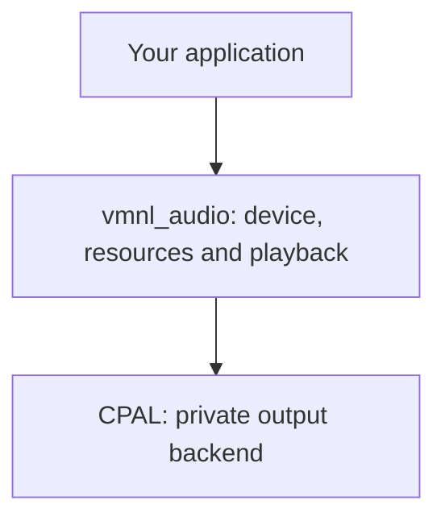

<div align="center">

# VMNL Audio

**Independent audio playback for Rust**

Cached sounds, streamed music, and explicit playback control with a private CPAL backend.

<br>


<br>

[](https://github.com/VMNL/vmnl-audio/actions/workflows/ci.yml)


</div>

---

> [!WARNING]
> **Experimental and not yet released.** The API may change while the initial `0.1.0` contract is
> prepared. Do not use in production.

## Table of Contents

- [Overview](#overview)
- [Design Principles](#design-principles)
- [Architecture](#architecture)
- [Status](#status)
- [Installation](#installation)
- [Building from Source](#building-from-source)
- [Examples](#examples)
- [Technical Documentation](#technical-documentation)
- [Contributing](#contributing)
- [References](#references)
- [License](#license)

---

## Overview

**VMNL Audio** is an independently usable Rust library for audio playback in games, engines, and
applications. Clients depend directly on `vmnl_audio`; its package owns playback, decoding, mixing,
and resource lifetimes.

| Type | Purpose |
| --- | --- |
| `AudioDevice` | Own native output and configure the control mode. |
| `Sound` | Cache decoded PCM for repeated sound playback. |
| `Music` | Stream music through a bounded PCM buffer per playback. |
| `SoundHandle` / `MusicHandle` | Control one playback instance and inspect its state and cursor. |

The library provides pause, resume, stop, volume, looping, and separate music/SFX bus controls.
Resources can create independent playback instances; cloned handles control the same instance.

---

## Design Principles

- **Explicit control** - manual control is the default; a control worker is an explicit opt-in.
- **Explicit ownership** - the device keeps output alive; resources and playback handles have
  separate responsibilities.
- **Documented costs** - loading, decoding, music refill, and cleanup belong to the control side.
- **Observable failures** - synchronous errors and background diagnostics remain available to callers.
- **Independent composition** - applications use the audio package directly, alongside their other
  libraries and their own application loop.

---

## Architecture



Keep `AudioDevice` alive for the duration of playback. `Sound` stores decoded PCM; each music
playback owns its decoder and bounded PCM ring. The output callback consumes prepared PCM and
mixes it for the device.

Two control modes share this ownership model:

- **Manual, by default** - the application calls `update()` from its control loop to process
  commands, refill music buffers, and clean up finished playbacks. No universal update cadence
  is guaranteed.
- **Automatic, explicit `.thread(true)`** - the library worker performs that control work.
  Clients do not need an `update()` or sleep loop for music refill.

CPAL manages output execution in both modes. Neither mode owns the application's event loop.
See [Architecture](docs/architecture.md) and the [audio contract](docs/audio.md) for boundaries,
threading, errors, and ownership invariants.

---

## Status

### Available - experimental

- Cached sounds and streamed music with independent playback instances.
- Pause/resume, terminal stop, volume, live loop controls, and consumed-frame cursors.
- Master and separate music/SFX buses with volume, mute, and pause controls.
- WAV, MP3, OGG/Vorbis, and FLAC decoding for supported mono/stereo sources.
- Stereo output at the resolved device rate, with source conversion and resampling.
- Manual and opt-in automatic control, plus background error diagnostics.

See [formats and restrictions](docs/api/appendices/formats.md), including unchanged channel/rate
requirements across chained OGG/Vorbis streams. Replaying a stopped resource creates a new handle;
resuming a stopped instance does not restart it.

### CI and native qualification

The platform badges represent CI coverage for builds and device-independent tests:

| Platform | CI architecture | Rust |
| --- | --- | --- |
| Linux | x86_64 GNU | 1.87.0 and stable |
| Windows | x86_64 MSVC | 1.87.0 and stable |
| macOS | aarch64 Apple Darwin | 1.87.0 and stable |

Hosted CI compiles native probes without executing them. Scoped Linux native results and partial
operator feedback are recorded in the [qualification inventory](docs/qualification.md).
Windows/macOS native output, detailed listening, device failure/recovery, and realtime timing remain
separate qualification work. See [platform support](docs/platform_support.md) for exact limits.

---

## Installation

No public release has been prepared. The `0.1.0` manifest version is development metadata; use a
development checkout and expect public contracts to change. From a neighboring application:

```toml
[dependencies]
vmnl_audio = { path = "../vmnl-audio" }
```

Import public types directly, for example `vmnl_audio::{AudioDevice, Sound, Music}`.
See [Getting Started](docs/getting_started.md) for the first playback and
[Deployment](docs/deployment.md) for the first publication's requirements.

### Requirements

- Rust 1.87 or newer, Cargo, and the platform linker/toolchain.
- A C compiler for the MP3 decoder dependency.
- On Linux, `pkg-config` and ALSA development headers/libraries, including for headless tests.
- For playback, a usable native audio output route.

See [Build prerequisites](docs/build.md) for platform setup and the explicit documentation-tool
installation procedure. Just is optional for Cargo builds and required for the `just` commands below.

---

## Building from Source

```sh
git clone https://github.com/VMNL/vmnl-audio.git
cd vmnl-audio
cargo build --all-targets --locked
```

With Just available, `just build` runs the repository's build recipe.
Generate item-level Rustdoc with `cargo doc --no-deps --locked`.

---

## Examples

With Just available, run the interactive controls or select an example:

```sh
just run
just run play_sound
just run stream_music
just run manual_control --help
```

`just run` selects `playback_controls`. It supports `pause`, `resume`, `volume 0.5`, `mute`,
`unmute`, `loop on`, `loop off`, `stop`, `play`, `status`, and `quit`.

The three ordinary examples explicitly enable `.thread(true)` and wait on stdin. The advanced
`manual_control` example shows caller-driven `update()` work. All examples use included synthetic
WAVs by default, accept an optional source path, and handle `--help` before opening a device.
Enter or stdin EOF exits; the interactive example also accepts `quit`.

Without Just:

```sh
cargo run --example playback_controls --locked
cargo run --example stream_music --locked -- /path/to/track.flac
cargo run --example manual_control --locked -- --help
```

See [Examples](docs/examples.md) for argument forwarding, diagnostics, control behavior, and
[asset generation and licensing](examples/assets/README.md).

---

## Technical Documentation

Start at the [documentation index](docs/README.md).

- [Getting Started](docs/getting_started.md) - direct dependency and first playback.
- [API book](docs/api/README.md) - concepts, usage workflows, and complete public reference.
- [Architecture](docs/architecture.md) - package, runtime, and ownership boundaries.
- [Audio contract](docs/audio.md) - technical invariants and acceptance requirements.
- [Build and tools](docs/build.md) - native prerequisites and explicit tool setup.
- [Testing](docs/testing.md#audio-tests) - deterministic tests and opt-in native probes.
- [Qualification status](docs/qualification.md) - recorded evidence and remaining requirements.
- [Deployment](docs/deployment.md) - packaging and manual release policy.
- [Extraction history](docs/history/audio_extraction.md) - source provenance and preserved commits.

---

## Contributing

Read [CONTRIBUTING.md](CONTRIBUTING.md) for the ordered checks and PR conventions, and
[Coding Instructions](docs/INSTRUCTIONS.md) before changing code or documentation.
Builds, deterministic tests, native execution, human listening, and realtime measurements provide
separate evidence; report what was actually checked.

---

## References

- [CPAL](https://docs.rs/cpal/0.18.2/cpal/) - private native output backend.
- [Codec adapters and format restrictions](docs/api/appendices/formats.md) - supported decoding paths.

---

## License

[MIT](LICENSE), including the bundled synthetic audio assets.
